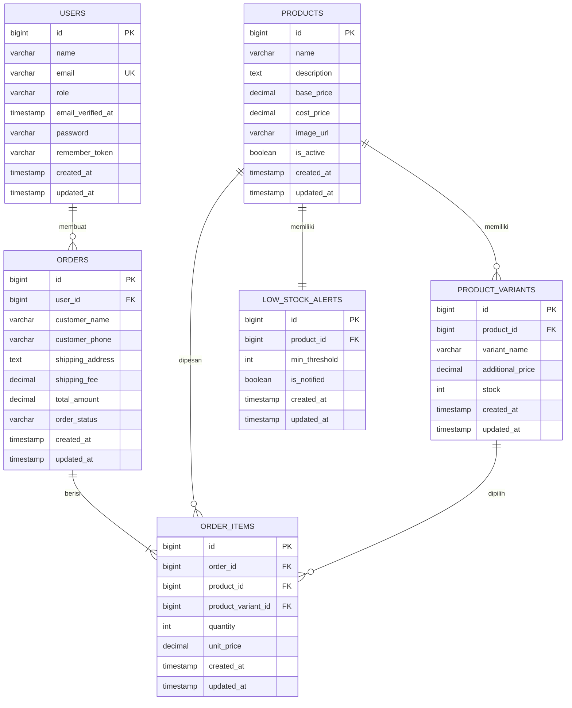

# Matcha and Me

Aplikasi pemesanan minuman matcha berbasis **Laravel 12 + Blade + Tailwind CSS v4**. Aplikasi ini melayani pemesanan dari sisi konsumen (katalog, keranjang, checkout, riwayat) dan pengelolaan dari sisi admin (dashboard, produk, stok, pesanan).

README ini menjelaskan cara menjalankan aplikasi **tanpa Docker**: mulai dari clone repository, instalasi dependency, konfigurasi database MySQL, migrasi, build frontend, sampai aplikasi tampil di browser.

---

## Fitur

### Konsumen
- Registrasi, login, dan logout.
- Melihat landing page, beranda, dan katalog menu.
- Memilih varian, tingkat gula, catatan, dan jumlah pada detail produk.
- Keranjang belanja berbasis session (tambah, ubah jumlah, hapus).
- Checkout sebagai tamu maupun pengguna yang login.
- Pilihan pesanan **diantar** (ongkir flat Rp10.000) atau **ambil sendiri**.
- Pilihan metode pembayaran saat checkout: **Tunai**, **QRIS**, atau **Transfer Bank**. Metode terkunci setelah pesanan dibuat.
- Riwayat pesanan; tamu melihat riwayat yang tersimpan di session browser.

### Admin
- Dashboard ringkasan omzet, pesanan, dan stok menipis.
- Daftar pesanan dengan filter status dan pencarian.
- Mengubah status pesanan: `PROCESSING`, `COMPLETED`, `CANCELLED`.
- Menandai pesanan **Tunai** sebagai lunas setelah uang diterima di gerai.
- CRUD produk beserta varian dan stok per varian.
- Halaman monitoring stok (perubahan stok dilakukan melalui form produk).

### Catatan scope
- Pembayaran online memakai Midtrans Snap: **QRIS** dan **Transfer Bank (Virtual Account)**.
- Pembayaran **Tunai** tidak memakai Midtrans dan dikonfirmasi manual oleh admin.
- Diskon member, laporan keuangan, notifikasi, manajemen user, dan login Google tidak termasuk dalam aplikasi ini.

---

## Teknologi

| Bagian | Teknologi |
|---|---|
| Backend | PHP 8.2+, Laravel 12 |
| Tampilan | Blade, Tailwind CSS v4, Bootstrap Icons (CDN) |
| Frontend build | Vite 7, Node.js 20.19+ |
| Database | MySQL 8 / MariaDB |
| Auth | Session Laravel (`Auth::attempt`) |
| Keranjang | Session Laravel |

---

## Prasyarat

Pastikan perangkat sudah memiliki:

1. **Git** — untuk clone repository.
2. **PHP 8.2 atau lebih baru**.
3. **Composer 2**.
4. **Node.js 20.19+ atau 22.12+** dan npm.
5. **MySQL 8 / MariaDB** — bisa dari XAMPP, Laragon, atau instalasi MySQL mandiri.

Cek versi yang terpasang:

```bash
git --version
php -v
composer -V
node -v
npm -v
```

Ekstensi PHP yang perlu aktif:

- `pdo_mysql`
- `mbstring`
- `openssl`
- `fileinfo`
- `ctype`
- `json`
- `tokenizer`
- `xml`
- `gd` (disarankan)
- `zip` (dibutuhkan Composer untuk beberapa paket)

### Jika memakai XAMPP (Windows)

1. Install XAMPP, lalu jalankan **Apache** dan **MySQL** dari XAMPP Control Panel.
2. Tambahkan folder PHP XAMPP ke `PATH`, misalnya `C:\xampp\php`, agar perintah `php` dan `composer` bisa dipakai dari terminal.
3. Buka `C:\xampp\php\php.ini`, pastikan baris berikut tidak diawali tanda `;`:

   ```ini
   extension=pdo_mysql
   extension=mbstring
   extension=openssl
   extension=fileinfo
   extension=gd
   extension=zip
   ```

4. Tutup dan buka kembali terminal setelah mengubah `php.ini`.

### Jika memakai Laragon (Windows)

1. Jalankan Laragon dan start **MySQL**.
2. Gunakan terminal Laragon agar `php`, `composer`, dan `mysql` sudah tersedia di `PATH`.

---

## 1. Clone repository

```bash
git clone https://github.com/pploke/laravel-matcha
cd laravel-matcha
```

---

## 2. Install dependency PHP

```bash
composer install
```

Jika muncul error ekstensi PHP, aktifkan ekstensi yang disebutkan pada bagian prasyarat, lalu ulangi perintah di atas.

---

## 3. Konfigurasi environment

Salin file contoh environment menjadi `.env`.

**Windows (Command Prompt / PowerShell):**

```bash
copy .env.example .env
```

**Linux / macOS:**

```bash
cp .env.example .env
```

Generate application key:

```bash
php artisan key:generate
```

Secara bawaan, `.env.example` sudah dikonfigurasi untuk MySQL. Buka `.env`, lalu cocokkan bagian berikut dengan MySQL di komputer Anda:

```env
APP_NAME="Matcha and Me"
APP_URL=http://127.0.0.1:8000

DB_CONNECTION=mysql
DB_HOST=127.0.0.1
DB_PORT=3306
DB_DATABASE=laravel_matcha
DB_USERNAME=root
DB_PASSWORD=
```

Penjelasan:

- `DB_HOST=127.0.0.1` digunakan karena MySQL berjalan langsung di komputer, **bukan** di container Docker.
- Pada XAMPP/Laragon, user default biasanya `root` dengan password kosong. Jika MySQL Anda memakai password, isi `DB_PASSWORD`.
- Nama database `laravel_matcha` hanya contoh; Anda boleh memakai nama lain selama nilainya sama dengan database yang dibuat pada langkah berikut.
- Biarkan `SESSION_DRIVER=database`, `CACHE_STORE=database`, dan `QUEUE_CONNECTION=database` seperti bawaan. Tabel pendukungnya dibuat otomatis oleh migrasi.

> Jika nanti mengubah `.env`, jalankan `php artisan config:clear` agar konfigurasi lama tidak tersimpan di cache.

---

## 4. Membuat database MySQL

### Cara 1: phpMyAdmin (paling mudah)

1. Buka `http://localhost/phpmyadmin`.
2. Klik **New** / **Baru**.
3. Isi nama database: `laravel_matcha`.
4. Pilih collation `utf8mb4_unicode_ci`.
5. Klik **Create**.

### Cara 2: terminal

Pastikan perintah `mysql` tersedia di `PATH`:

```bash
mysql -u root -p -e "CREATE DATABASE laravel_matcha CHARACTER SET utf8mb4 COLLATE utf8mb4_unicode_ci;"
```

Jika password root kosong, tekan Enter saat diminta password.

---

## 5. Migrasi dan isi data demo

```bash
php artisan migrate --seed
```

Perintah ini akan:

- Membuat seluruh tabel aplikasi.
- Mengisi data demo: 5 user, 5 produk, 8 varian, dan 5 pesanan.

Jika ingin mengulang dari database kosong:

```bash
php artisan migrate:fresh --seed
```

> **Peringatan:** `migrate:fresh` menghapus seluruh tabel dan data di database yang dikonfigurasi. Jangan jalankan pada database yang berisi data penting.

Seeder aplikasi ini memakai perintah khusus MySQL (`SET FOREIGN_KEY_CHECKS`). Karena itu, gunakan MySQL/MariaDB, bukan SQLite, agar seed berjalan tanpa penyesuaian kode.

---

## 6. Install dependency frontend dan build aset

```bash
npm install
npm run build
```

`npm run build` menghasilkan file CSS/JS di `public/build`. File inilah yang dipakai Laravel saat halaman dibuka.

Jika sedang mengembangkan tampilan dan ingin hot reload, gunakan:

```bash
npm run dev
```

Biarkan terminal `npm run dev` tetap berjalan, lalu jalankan Laravel di terminal lain. Saat memakai `npm run dev`, Anda tidak perlu menjalankan `npm run build` terlebih dahulu.

---

## 7. Jalankan aplikasi

Dari folder `laravel-matcha`:

```bash
php artisan serve
```

Buka browser:

```text
http://127.0.0.1:8000
```

Jika berhasil, akan tampil **landing page Matcha and Me** dengan hero bertuliskan “Nikmati Keaslian Matcha Alami”.

Jika port `8000` sudah dipakai:

```bash
php artisan serve --port=8001
```

Lalu buka `http://127.0.0.1:8001` dan sesuaikan `APP_URL` di `.env` menjadi `http://127.0.0.1:8001`.

### Ringkasan terminal yang harus berjalan

| Skenario | Terminal 1 | Terminal 2 |
|---|---|---|
| Mode produksi/lokal biasa | `php artisan serve` | — (cukup, setelah `npm run build`) |
| Mode development | `php artisan serve` | `npm run dev` |

---

## 8. Akun demo

Data berikut berasal dari `DatabaseSeeder`:

| Role | Email | Password |
|---|---|---|
| Admin | `admin@matcha.com` | `admin123` |
| Konsumen | `fauzan@gmail.com` | `password123` |
| Konsumen | `vanka@gmail.com` | `password123` |
| Konsumen | `arfian@gmail.com` | `password123` |
| Konsumen | `siti@gmail.com` | `password123` |

Setelah login:

- Admin diarahkan ke `/admin`.
- Konsumen diarahkan ke landing page dan bisa memesan melalui katalog.

---

## 9. Alur pertama kali membuka aplikasi

1. Buka `http://127.0.0.1:8000` → landing page.
2. Klik **Katalog** atau **Lihat Menu Kami** untuk melihat produk.
3. Pilih produk, tentukan varian/gula/catatan, lalu tambahkan ke keranjang.
4. Buka **Keranjang**, lanjut ke **Checkout**, isi data penerima, pilih **Diantar** atau **Ambil sendiri**, lalu pilih metode pembayaran **Tunai**, **QRIS**, atau **Transfer Bank**.
5. Setelah pesanan dibuat:
   - **Tunai**: diarahkan ke halaman pembayaran berisi instruksi bayar di gerai. Admin menandai lunas setelah uang diterima.
   - **QRIS / Transfer Bank**: diarahkan ke halaman pembayaran Midtrans. Jika Midtrans dikonfigurasi, tombol bayar akan muncul; jika tidak, pembuatan token akan gagal dan pesanan tetap tersimpan di **Riwayat Pesanan**.
6. Untuk masuk sebagai admin, buka `/login`, gunakan akun admin, lalu Anda akan diarahkan ke dashboard `/admin`.

Halaman penting:

| Halaman | URL |
|---|---|
| Landing | `/` |
| Beranda konsumen | `/beranda` |
| Katalog | `/katalog` |
| Keranjang | `/keranjang` |
| Checkout | `/checkout` |
| Pembayaran | `/payments/{id}` |
| Riwayat pesanan | `/riwayat-pesanan` |
| Login | `/login` |
| Register | `/register` |
| Dashboard admin | `/admin` |
| Produk admin | `/admin/produk` |
| Stok admin | `/admin/stok` |
| Pesanan admin | `/admin/pesanan` |

---

## 10. Integrasi pembayaran Midtrans (opsional)

Fitur pembayaran online memakai Midtrans Snap (mode sandbox). Tanpa kredensial, aplikasi tetap bisa dipakai untuk memesan, tetapi pembayaran QRIS/Transfer Bank tidak dapat diproses.

| Metode | Cara bayar | Status awal pesanan |
|---|---|---|
| **Tunai** | Bayar di gerai atau saat pesanan diantar (COD). Tidak memakai Midtrans. | `PROCESSING`, `UNPAID` sampai admin menandai lunas |
| **QRIS** | Scan QRIS melalui Midtrans Snap. | `PENDING_PAYMENT`, `UNPAID` |
| **Transfer Bank** | Virtual Account melalui Midtrans Snap. | `PENDING_PAYMENT`, `UNPAID` |

Metode dipilih sekali di halaman checkout dan tidak dapat diubah setelah pesanan dibuat.

1. Daftar/masuk ke [dashboard Midtrans](https://dashboard.sandbox.midtrans.com/), lalu salin **Server Key** dan **Client Key** dari menu *Settings → Access Keys*.
2. Isi variabel berikut di `.env`:

   ```env
   MIDTRANS_MERCHANT_ID=G123456789
   MIDTRANS_CLIENT_KEY=SB-Mid-client-xxxxxxxx
   MIDTRANS_SERVER_KEY=SB-Mid-server-xxxxxxxx
   MIDTRANS_IS_PRODUCTION=false
   ```

3. Aktifkan kanal pembayaran di dashboard Midtrans (*Settings → Payment Channels*):
   - **QRIS** (`other_qris`)
   - **Virtual Account**: BCA, BNI, BRI, Permata, Mandiri Bill (`echannel`), dan `other_va`

   Kanal yang belum aktif dapat membuat Midtrans menolak permintaan pembuatan transaksi Snap.

4. Bersihkan cache konfigurasi:

   ```bash
   php artisan config:clear
   ```

5. Agar notifikasi pembayaran (webhook) masuk ke laptop lokal, jalankan tunnel:

   ```bash
   ngrok http 8000
   ```

   Lalu isi **Payment Notification URL** di dashboard Midtrans dengan:

   ```text
   https://<domain-ngrok>/payments/midtrans/notification
   ```

   Set `APP_URL` di `.env` ke domain ngrok yang sama, lalu jalankan `php artisan config:clear`.

6. Alur verifikasi:

   - **Tunai** → pesanan langsung berstatus `PROCESSING` tanpa baris `payments` dan tanpa token Snap. Admin menekan **Tandai Lunas** di halaman pesanan admin setelah uang diterima.
   - **QRIS / Transfer Bank** → checkout otomatis membuat baris `payments` + Snap token dengan kanal yang dibatasi sesuai metode → diarahkan ke `/payments/{id}`.
   - Klik **Buka Pembayaran Midtrans** → bayar memakai simulator sandbox.
   - Halaman pembayaran melakukan *polling* ke `/payments/{id}/status` tiap 3 detik (5 detik untuk pesanan tunai). Status akan berubah menjadi **PAID** walaupun webhook belum masuk.
   - Jika webhook aktif, notifikasi Midtrans juga memperbarui `orders.payment_status` dan `order_status` secara otomatis.

Admin tidak dapat menyelesaikan (`COMPLETED`) pesanan yang belum lunas. Tandai lunas terlebih dahulu, lalu ubah status pesanan menjadi selesai. Tanpa ngrok, pembayaran online tetap bisa diverifikasi lewat *polling* selama halaman pembayaran masih terbuka. Webhook hanya diperlukan agar status tetap sinkron saat tab ditutup.

---

## Troubleshooting

| Masalah | Penyebab umum | Solusi |
|---|---|---|
| `could not find driver` | Ekstensi `pdo_mysql` belum aktif | Aktifkan `extension=pdo_mysql` di `php.ini`, lalu buka terminal baru |
| `Access denied for user 'root'@'localhost'` | `DB_USERNAME` / `DB_PASSWORD` salah | Sesuaikan kredensial MySQL di `.env` |
| `Unknown database 'laravel_matcha'` | Database belum dibuat | Buat database melalui phpMyAdmin atau terminal |
| `Vite manifest not found` | Aset frontend belum dibuild | Jalankan `npm install && npm run build`, atau jalankan `npm run dev` |
| Halaman putih / error 500 | `APP_KEY` kosong, database belum dimigrasi, atau permission salah | Jalankan `php artisan key:generate`, `php artisan migrate --seed`, cek `storage/logs/laravel.log` |
| `php artisan` tidak dikenali | PHP belum masuk `PATH` | Gunakan terminal Laragon/XAMPP atau tambahkan folder PHP ke `PATH` |
| `npm` gagal karena versi Node terlalu lama | Vite 7 membutuhkan Node 20.19+ | Install Node.js LTS 22, lalu ulangi `npm install` |
| Port 8000 sudah dipakai | Ada proses lain di port tersebut | `php artisan serve --port=8001` dan sesuaikan `APP_URL` |
| Perubahan `.env` tidak terbaca | Konfigurasi tersimpan di cache | `php artisan config:clear` |
| Permission denied di Linux/macOS | Folder `storage` / `bootstrap/cache` tidak bisa ditulis | `chmod -R 775 storage bootstrap/cache` |
| Data demo tidak muncul | Migrasi dijalankan tanpa `--seed` | `php artisan db:seed` atau `php artisan migrate:fresh --seed` |
| Pembayaran gagal / token tidak muncul | `MIDTRANS_SERVER_KEY` atau `MIDTRANS_CLIENT_KEY` kosong/salah | Isi kredensial sandbox di `.env`, lalu `php artisan config:clear` |
| Status pembayaran tidak berubah setelah bayar | Halaman pembayaran ditutup sebelum polling selesai dan webhook tidak aktif | Buka kembali `/payments/{id}` atau pasang ngrok dan daftarkan Notification URL |

Jika masih error, buka file `storage/logs/laravel.log` untuk melihat pesan lengkapnya.

---

## Struktur proyek (ringkas)

```text
laravel-matcha/
├── app/
│   ├── Http/
│   │   ├── Controllers/
│   │   │   ├── Admin/
│   │   │   ├── AuthController.php
│   │   │   ├── CartController.php
│   │   │   ├── CatalogController.php
│   │   │   ├── CheckoutController.php
│   │   │   ├── HomeController.php
│   │   │   └── OrderHistoryController.php
│   │   └── Middleware/EnsureRole.php
│   ├── Models/
│   ├── Services/CartService.php
│   └── Support/Navigation.php
├── database/
│   ├── migrations/
│   └── seeders/DatabaseSeeder.php
├── resources/
│   ├── css/app.css
│   └── views/
│       ├── admin/
│       ├── auth/
│       ├── components/
│       ├── katalog/
│       ├── beranda.blade.php
│       ├── checkout.blade.php
│       ├── keranjang.blade.php
│       ├── landing.blade.php
│       └── riwayat.blade.php
├── routes/web.php
├── .env.example
├── composer.json
└── package.json
```

---

## Opsional: menjalankan dengan Docker

Cara utama di README ini adalah tanpa Docker. Jika ingin memakai Docker, repo sudah menyediakan `docker-compose.yml`.

1. Salin `.env.example` menjadi `.env`, lalu sesuaikan:

   ```env
   APP_NAME="Matcha and Me"
   APP_URL=http://localhost:8000

   DB_CONNECTION=mysql
   DB_HOST=mysql
   DB_PORT=3306
   DB_DATABASE=laravel_db
   DB_USERNAME=sail
   DB_PASSWORD=password
   ```

2. Build frontend di host (container aplikasi tidak menyediakan Node):

   ```bash
   npm install
   npm run build
   ```

3. Jalankan container:

   ```bash
   docker compose up -d --build
   ```

4. Generate key dan migrasi dari dalam container:

   ```bash
   docker exec laravel_app php artisan key:generate
   docker exec laravel_app php artisan migrate --seed
   ```

5. Buka:

   - Aplikasi: `http://localhost:8000`
   - phpMyAdmin: `http://localhost:8081`

Untuk menghentikan container:

```bash
docker compose down
```

---

# Struktur Database

Bagian ini menjelaskan tabel yang dibuat oleh migrasi Laravel. Database menggunakan MySQL/MariaDB.

## ERD



## Relasi

- **users → orders**: satu user dapat memiliki banyak pesanan. `orders.user_id` boleh `NULL` karena tamu dapat checkout tanpa akun.
- **products → product_variants**: satu produk memiliki banyak varian. Menghapus produk akan menghapus variannya (`ON DELETE CASCADE`).
- **products → low_stock_alerts**: satu produk memiliki satu konfigurasi batas stok minimum.
- **orders → order_items**: satu pesanan memiliki banyak item. Menghapus pesanan akan menghapus itemnya (`ON DELETE CASCADE`).
- **products → order_items**: item pesanan merujuk produk yang dipesan. Produk yang sudah dipakai di pesanan tidak dapat dihapus (restrict).
- **product_variants → order_items**: item pesanan dapat merujuk varian yang dipilih. Varian yang sudah dipakai di pesanan tidak dapat dihapus (restrict).

## Tabel `users`

Menyimpan akun admin dan konsumen.

| Kolom | Tipe | Keterangan |
|---|---|---|
| `id` | BIGINT UNSIGNED | Primary key, auto increment |
| `name` | VARCHAR(255) | Nama pengguna |
| `email` | VARCHAR(255) | Unik, dipakai untuk login |
| `role` | VARCHAR(255) | Default `CUSTOMER`; nilai: `ADMIN`, `CUSTOMER` |
| `email_verified_at` | TIMESTAMP NULL | Tidak dipakai di alur aplikasi |
| `password` | VARCHAR(255) | Hash password (bcrypt) |
| `remember_token` | VARCHAR(100) NULL | Untuk fitur “Ingat saya” |
| `created_at` | TIMESTAMP NULL | Waktu dibuat |
| `updated_at` | TIMESTAMP NULL | Waktu diperbarui |

## Tabel `products`

Menyimpan data menu/produk.

| Kolom | Tipe | Keterangan |
|---|---|---|
| `id` | BIGINT UNSIGNED | Primary key, auto increment |
| `name` | VARCHAR(255) | Nama produk |
| `description` | TEXT NULL | Deskripsi produk |
| `base_price` | DECIMAL(10,2) | Harga dasar |
| `cost_price` | DECIMAL(10,2) | Harga modal, default `0` |
| `image_url` | VARCHAR(255) NULL | URL foto; jika kosong memakai ilustrasi bawaan |
| `is_active` | BOOLEAN | Default `true`; produk nonaktif tidak tampil di katalog |
| `created_at` | TIMESTAMP NULL | Waktu dibuat |
| `updated_at` | TIMESTAMP NULL | Waktu diperbarui |

## Tabel `product_variants`

Menyimpan varian produk beserta stok dan tambahan harga.

| Kolom | Tipe | Keterangan |
|---|---|---|
| `id` | BIGINT UNSIGNED | Primary key, auto increment |
| `product_id` | BIGINT UNSIGNED | Foreign key → `products.id`, `ON DELETE CASCADE` |
| `variant_name` | VARCHAR(255) | Nama varian, mis. “Cup Besar” |
| `additional_price` | DECIMAL(10,2) | Tambahan harga, default `0` |
| `stock` | INT | Jumlah stok varian, default `0` |
| `created_at` | TIMESTAMP NULL | Waktu dibuat |
| `updated_at` | TIMESTAMP NULL | Waktu diperbarui |

## Tabel `low_stock_alerts`

Menyimpan batas minimum stok per produk untuk peringatan stok menipis.

| Kolom | Tipe | Keterangan |
|---|---|---|
| `id` | BIGINT UNSIGNED | Primary key, auto increment |
| `product_id` | BIGINT UNSIGNED | Foreign key unik → `products.id`, `ON DELETE CASCADE` |
| `min_threshold` | INT | Batas minimum stok, default `5` |
| `is_notified` | BOOLEAN | Status notifikasi, default `false` |
| `created_at` | TIMESTAMP NULL | Waktu dibuat |
| `updated_at` | TIMESTAMP NULL | Waktu diperbarui |

## Tabel `orders`

Menyimpan data pesanan.

| Kolom | Tipe | Keterangan |
|---|---|---|
| `id` | BIGINT UNSIGNED | Primary key, auto increment |
| `user_id` | BIGINT UNSIGNED NULL | Foreign key → `users.id`, `ON DELETE SET NULL`; `NULL` untuk pesanan tamu |
| `customer_name` | VARCHAR(255) | Nama penerima/pengambil |
| `customer_phone` | VARCHAR(255) | Nomor telepon |
| `shipping_address` | TEXT | Alamat pengiriman, atau keterangan “Ambil di tempat” |
| `shipping_fee` | DECIMAL(10,2) | Ongkir; `0` untuk ambil sendiri |
| `total_amount` | DECIMAL(10,2) | Total akhir pesanan |
| `order_status` | VARCHAR(255) | Default `PROCESSING` |
| `payment_method` | VARCHAR(255) NULL | `CASH`, `QRIS`, atau `BANK_TRANSFER`; pesanan lama diisi `MIDTRANS` |
| `created_at` | TIMESTAMP NULL | Waktu pesanan dibuat |
| `updated_at` | TIMESTAMP NULL | Waktu diperbarui |

Nilai `order_status`:

| Nilai | Arti |
|---|---|
| `PENDING_PAYMENT` | Menunggu pembayaran (disiapkan untuk pengembangan lanjutan) |
| `PROCESSING` | Sedang diproses (status awal pesanan baru) |
| `COMPLETED` | Selesai |
| `CANCELLED` | Dibatalkan |

## Tabel `order_items`

Menyimpan rincian item pada setiap pesanan.

| Kolom | Tipe | Keterangan |
|---|---|---|
| `id` | BIGINT UNSIGNED | Primary key, auto increment |
| `order_id` | BIGINT UNSIGNED | Foreign key → `orders.id`, `ON DELETE CASCADE` |
| `product_id` | BIGINT UNSIGNED | Foreign key → `products.id` (restrict) |
| `product_variant_id` | BIGINT UNSIGNED NULL | Foreign key → `product_variants.id` (restrict), boleh `NULL` |
| `quantity` | INT | Jumlah item |
| `unit_price` | DECIMAL(10,2) | Harga satuan saat transaksi |
| `created_at` | TIMESTAMP NULL | Waktu dibuat |
| `updated_at` | TIMESTAMP NULL | Waktu diperbarui |

> Harga pada `order_items.unit_price` disimpan ulang saat checkout. Harga dihitung di server dari `products.base_price + product_variants.additional_price`, bukan dari nilai yang dikirim browser.

## Tabel bawaan Laravel

Tabel berikut dibuat otomatis oleh migrasi Laravel dan mendukung session, cache, serta queue. Tidak perlu diisi manual.

| Tabel | Fungsi |
|---|---|
| `password_reset_tokens` | Menyimpan token reset password (fitur reset password tidak dipakai di UI) |
| `sessions` | Menyimpan session login dan keranjang (`SESSION_DRIVER=database`) |
| `cache` | Menyimpan cache aplikasi (`CACHE_STORE=database`) |
| `cache_locks` | Lock untuk cache |
| `jobs` | Queue job (`QUEUE_CONNECTION=database`) |
| `job_batches` | Batch job |
| `failed_jobs` | Job yang gagal |

## Data demo hasil seeder

| Data | Jumlah |
|---|---|
| User | 5 (1 admin, 4 konsumen) |
| Produk | 5 |
| Varian produk | 8 |
| Pesanan | 5 |

Untuk mengembalikan database ke kondisi demo:

```bash
php artisan migrate:fresh --seed
```
